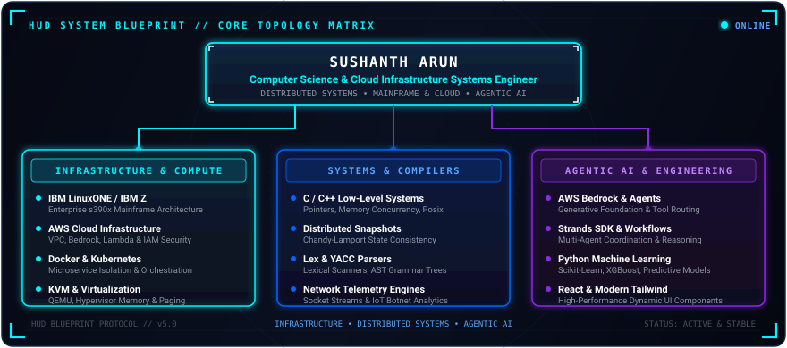

  <!-- Typewriter Header Banner -->
  

  

    <strong>Computer Science &bull; Distributed Systems Architecture &bull; Cloud Infrastructure &bull; Agentic AI</strong>
  

  <!-- Stark Tech / Marvel Quote -->
  <blockquote align="center">
    <em>"Proof that computer science can build the future."</em> &mdash; Inspired by Stark Tech Architecture.
  </blockquote>

  <!-- HUD Quick Telemetry Badges -->
  

    
    
    
    
  

---

### 🛰️ System Architecture Topology

  

---

### 🛠️ Core Tech Stack & Capabilities

  <strong>Languages</strong> 
  
  
  
  
  
  

  <strong>Cloud &amp; DevOps Architecture</strong> 
  
  
  
  
  
  
  

  <strong>Frontend &amp; Frameworks</strong> 
  
  
  
  

  <strong>AI, Systems &amp; Quantum</strong> 
  
  
  

<!-- Skillicons Row -->

  

---

### 📊 Telemetry & System Metrics

  <table border="0" cellspacing="0" cellpadding="0">
    <tr>
      <td align="center" valign="middle">
        
      </td>
      <td align="center" valign="middle">
        
      </td>
    </tr>
  </table>

---

### 🌌 Stark-Tech Contribution Matrix

  

---

### 📡 Connect & Comm Channels

  
  
  

