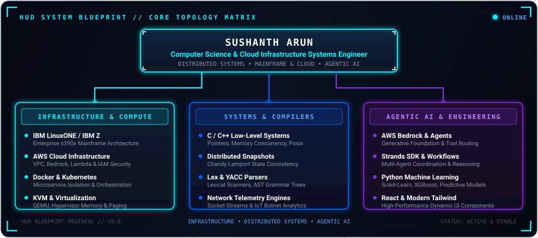
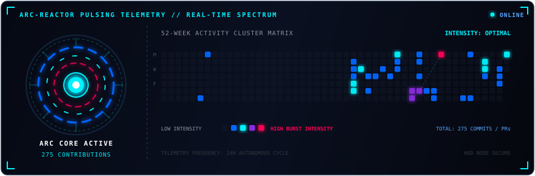

  <!-- Typewriter Header Banner -->
  

  

    <strong>Computer Science &bull; Distributed Systems Architecture &bull; IBM Z / LinuxONE &bull; AWS Cloud &bull; Agentic AI</strong>
  

  <!-- High-Tech Engineering Quote -->
  <blockquote align="center">
    <em>"Architecting distributed scale, enterprise compute, and autonomous agentic intelligence."</em>
  </blockquote>

  <!-- HUD Quick Telemetry Badges -->
  

    
    
    
    
    
  

---

### 🛰️ System Architecture Topology

  

---

### 🛠️ Core Tech Stack & Capabilities

  <strong>Cloud &amp; DevOps Architecture</strong> 
  
  
  
  
  
  
  
  
  
  

  <strong>AI, Systems &amp; Quantum</strong> 
  
  
  
  
  
  

  <strong>Languages</strong> 
  
  
  
  
  
  
  

  <strong>Frontend &amp; Frameworks</strong> 
  
  
  
  
  
  
  

<!-- Skillicons Row -->

  

---

### 🚀 Featured Systems & Active Deployments

<table border="0" width="100%">
  <!-- Row 1: FlowCast AI & T2D Home Foods App -->
  <tr>
    <td width="50%" valign="top">
      <h3 align="left">
        <a href="https://github.com/sushanth-arun/FlowCastAI">🌊 FlowCast AI</a>
      </h3>
      

        <em>Supply-Chain Decision Support System &bull; IBM Z Global 3rd Place</em>
      

      

        
        
        
        
      

      <ul>
        <li>Trained 3 ML inference models (asset health, shipment delay, stockout risk) in PyTorch/XGBoost; 97% classification accuracy.</li>
        <li>Deployed on <b>IBM LinuxONE (s390x)</b> with ONNX runtime SIMD optimization, achieving &lt;0.02ms latency &amp; 57K–78K req/sec.</li>
        <li>Engineered a 3-warehouse rebalancing solver preserving safety-stock bounds, simulating $13,350 net disruption savings.</li>
      </ul>
      

        <a href="https://github.com/sushanth-arun/FlowCastAI"><b>Inspect Repository &rarr;</b></a>
      

    </td>
    <td width="50%" valign="top">
      <h3 align="left">
        <a href="https://github.com/sushanth-arun/t2d-home-foods-app">🍱 T2D Home Foods App</a>
      </h3>
      

        <em>Cross-Platform Mobile Ordering &amp; Cloud Kitchen Operations Engine</em>
      

      

        
        
        
        
      

      <ul>
        <li>Architecting a production-grade cross-platform food delivery app in <b>Flutter &amp; Dart</b> with reactive Cloud Firestore streams.</li>
        <li>Implemented multi-role operational architecture (Customer App &amp; Executive Admin Suite) with granular RBAC Firestore security rules.</li>
        <li>Integrated Phone OTP authentication, Razorpay payment gateway, dynamic meal capacity scheduling, and bilingual (EN/Tamil) localization.</li>
      </ul>
      

        <a href="https://github.com/sushanth-arun/t2d-home-foods-app"><b>Inspect Repository &rarr;</b></a> &bull; <em>Active Development</em>
      

    </td>
  </tr>
  <!-- Row 2: Project Tambo & AI Image Authenticity -->
  <tr>
    <td width="50%" valign="top">
      <h3 align="left">
        <a href="https://github.com/sushanth-arun">🏢 Project Tambo</a>
      </h3>
      

        <em>Smart Residence 3D Dashboard &bull; Spatial Living Management</em>
      

      

        
        
        
        
      

      <ul>
        <li>Interactive residence dashboard featuring admin/resident flows, unit-aware routing, and access guards.</li>
        <li>GPU-accelerated WebGL backgrounds using Three.js/OGL for immersive 3D spatial monitoring.</li>
        <li>Embedded Tambo AI SDK for real-time telemetry, visual charts, and utility consumption insights.</li>
      </ul>
    </td>
    <td width="50%" valign="top">
      <h3 align="left">
        <a href="https://github.com/sushanth-arun">🔍 AI Image Authenticity Detector</a>
      </h3>
      

        <em>Computer Vision &amp; Synthetic Forgery Defense &bull; National Finalist</em>
      

      

        
        
        
        
      

      <ul>
        <li>Multi-stage detection framework thwarting synthetic review fraud via CNN classification and metadata forensics.</li>
        <li>Frequency-domain spatial analysis pipeline isolating GAN and diffusion pattern artifacts.</li>
        <li>Async FastAPI microservice delivering real-time scoring; recognized as Yukta National Hackathon Finalist.</li>
      </ul>
    </td>
  </tr>
</table>

---

### 📊 Telemetry & System Metrics

  <table border="0" cellspacing="0" cellpadding="0">
    <tr>
      <td align="center" valign="middle">
        
      </td>
      <td align="center" valign="middle">
        
      </td>
    </tr>
  </table>

---

### ⚛️ Arc-Reactor Holographic Contribution Matrix

  

---

### 📡 Connect & Comm Channels

  
  
  

